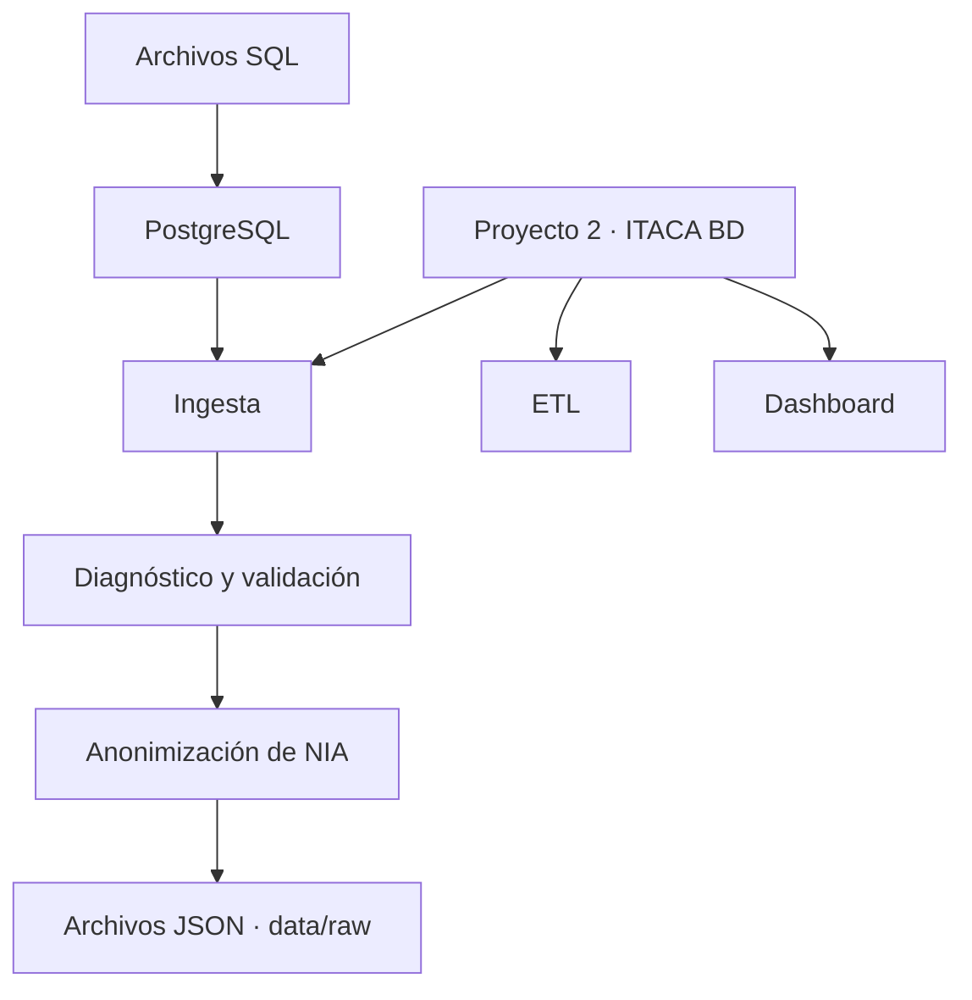

# Proyecto 2 · ITACA BD

## Descripción y objetivo

Este repositorio corresponde al Proyecto 2 del módulo de Big Data.

El proyecto trabaja con datos académicos de la plataforma ITACA almacenados en PostgreSQL.

El objetivo de esta primera parte es realizar la ingesta de los datos, anonimizar los identificadores de los alumnos y generar archivos JSON para las siguientes fases del proyecto.

## Arquitectura



El diagrama muestra el flujo de trabajo del proyecto, desde los archivos SQL originales hasta la generación de los archivos JSON anonimizados.

## Estructura del repositorio

```text
bigdata-p2-itaca-bd/
├── ingesta/
│   └── ingesta_itaca_bd.py
├── sql/
│   ├── alumnos.sql
│   ├── calificaciones.sql
│   ├── contenidos.sql
│   ├── cursos.sql
│   └── grupos.sql
├── data/
│   └── raw/
├── etl/
├── dashboard/
├── evidencias/
├── docker-compose.yml
├── .gitignore
└── README.md
```

## Entorno de trabajo

Para este proyecto se utilizan:

- Docker y Docker Compose.
- PostgreSQL 16.
- Python y un entorno virtual.
- `psycopg2-binary` para la conexión con PostgreSQL.
- `python-dotenv` para cargar las variables de entorno.
- `pandas`.

La base de datos utilizada se llama `itaca_academico`.

Se han creado dos usuarios:

- `itaca_admin`: usuario administrador.
- `lectura_bigdata`: usuario utilizado por el script de ingesta, con permisos de lectura sobre las tablas.

## Ingesta de datos

El proceso se encuentra en `ingesta/ingesta_itaca_bd.py`.

Los datos originales proceden de cinco archivos SQL, que se utilizan para crear y cargar las tablas correspondientes en PostgreSQL:

- `alumnos`
- `calificaciones`
- `contenidos`
- `cursos`
- `grupos`

El script realiza las siguientes operaciones:

1. Lee los datos de conexión desde el archivo `.env`.
2. Establece la conexión con PostgreSQL.
3. Extrae los campos seleccionados de las cinco tablas.
4. Diagnostica las referencias de alumnos y los valores de grupo antes de anonimizar los identificadores.
5. Anonimiza los NIA mediante SHA-256 truncado.
6. Aplica la misma anonimización a los identificadores de alumnos presentes en las calificaciones.
7. Valida las referencias entre alumnos, calificaciones, contenidos y grupos.
8. Guarda los resultados en archivos JSON dentro de `data/raw/`.

Los archivos generados siguen este formato:

```text
data/raw/
├── alumnos_FECHA.json
├── calificaciones_FECHA.json
├── contenidos_FECHA.json
├── cursos_FECHA.json
└── grupos_FECHA.json
```

La fecha corresponde al día de ejecución del proceso.

## Validación de claves

Durante la ingesta se comprueban las referencias entre las tablas utilizando el año académico y el identificador correspondiente.

El diagnóstico se realiza antes de anonimizar los NIA, mientras que la validación definitiva se ejecuta después de la anonimización.

### Resultados de la validación

| Comprobación                             | Resultado |
| ---------------------------------------- | --------: |
| Referencias de alumnos no encontradas    |       188 |
| Referencias de contenidos no encontradas |         0 |
| Referencias de grupos no encontradas     |        54 |

### Incidencias detectadas

**Referencias de alumnos**

Se han detectado 188 referencias no encontradas, todas correspondientes al año 2023.

El diagnóstico previo a la anonimización ha permitido clasificar estas referencias:

- 55 referencias corresponden a identificadores que aparecen en `alumnos`, pero asociados a otro año.
- 133 referencias corresponden a identificadores que no aparecen en la tabla `alumnos`.
- Las 188 referencias corresponden a 9 identificadores distintos.
- No se han detectado referencias nulas ni diferencias atribuibles a espacios adicionales en los identificadores.

**Referencias de grupos**

Se han detectado 54 referencias cuyo campo `grupo` contiene un espacio en blanco o está compuesto únicamente por espacios.

**Referencias de contenidos**

No se han detectado errores. Todas las referencias comprobadas encuentran correspondencia.

### Resultado final

Las incidencias detectadas quedan registradas mediante mensajes de diagnóstico y advertencia.

No se modifican ni eliminan los registros originales por estas incidencias. El proceso continúa y genera correctamente los cinco archivos JSON anonimizados en `data/raw/`.

## Estado del proyecto

- [x] Repositorio Git inicializado en la rama `main`.
- [x] Estructura inicial de carpetas creada.
- [x] Archivo `.gitignore` configurado.
- [x] Entorno Docker y PostgreSQL preparado.
- [x] Archivos SQL de ITACA incorporados.
- [x] Tablas de ITACA importadas en PostgreSQL.
- [x] Usuario de lectura configurado y permisos comprobados.
- [x] Script de ingesta desarrollado y ejecutado correctamente.
- [x] Diagnóstico de referencias realizado.
- [x] Validación de claves realizada.
- [x] Anonimización de NIA realizada.
- [x] Archivos JSON generados.
- [x] Capturas de evidencias realizadas.
