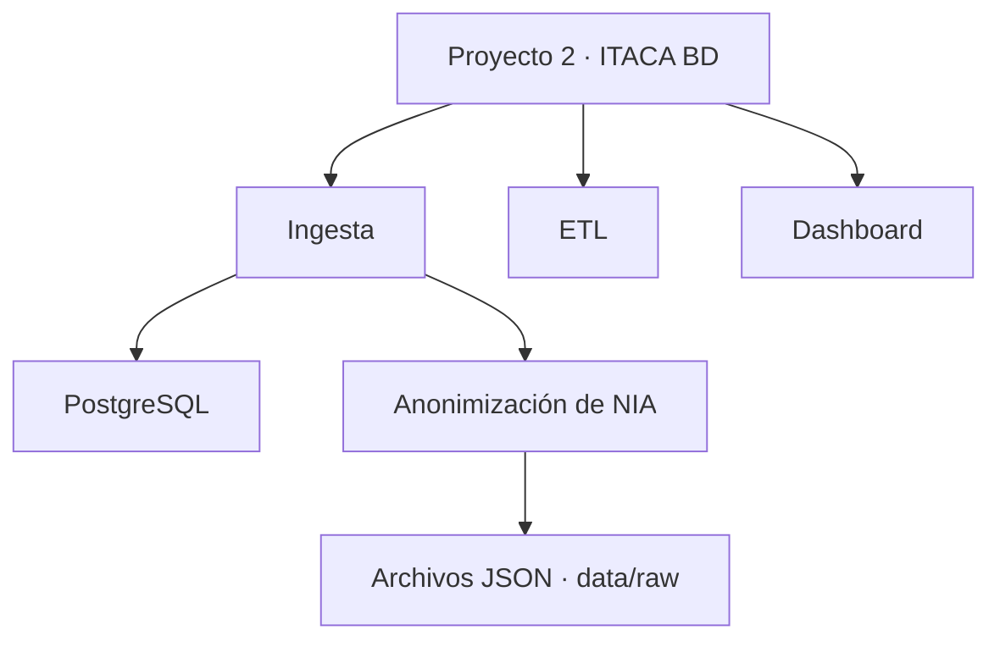

# Proyecto 2 · ITACA BD

## Descripción y objetivo

Este repositorio corresponde al Proyecto 2 del módulo de Big Data.

El proyecto trabaja con datos académicos de la plataforma ITACA en BBDD.

## Arquitectura



El diagrama muestra la estructura inicial del repositorio y sirve como referencia para organizar sus distintos componentes. Esta estructura podrá evolucionar a medida que se desarrolle el proyecto.

## Estructura del repositorio

```text
bigdata-p2-itaca-bd/
├── ingesta/
│   └── ingesta_itaca_bd.py
├── etl/
├── dashboard/
├── evidencias/
├── docker-compose.yml
├── .gitignore
└── README.md
```

## Entorno de trabajo

Para este proyecto se utilizan:

- Docker y Docker Compose.
- PostgreSQL 16.
- Python y un entorno virtual.
- `psycopg2-binary` para la conexión con PostgreSQL.
- `python-dotenv` para cargar las variables de entorno.
- `pandas`.

La base de datos utilizada se llama `itaca_academico`.

Se han creado dos usuarios:

- `itaca_admin`: usuario administrador.
- `lectura_bigdata`: usuario utilizado por el script de ingesta, con permisos de lectura sobre las tablas.

## Ingesta de datos

El proceso se encuentra en `ingesta/ingesta_itaca_bd.py`.

El script realiza las siguientes operaciones:

1. Lee los datos de conexión desde el archivo `.env`.
2. Establece la conexión con PostgreSQL.
3. Extrae los campos seleccionados de las tablas.
4. Anonimiza los NIA mediante SHA-256.
5. Aplica la misma anonimización a los identificadores de alumnos presentes en las calificaciones.
6. Guarda los resultados en archivos JSON dentro de `data/raw/`.

Para esta implementación se han utilizado cinco tablas:

- `alumnos`
- `calificaciones`
- `contenidos`
- `cursos`
- `grupos`

- [x] Repositorio Git inicializado en la rama `main`.
- [x] Estructura inicial de carpetas creada.
- [x] Archivo `.gitignore` configurado.
- [x] Entorno Docker y PostgreSQL preparado.
- [x] Tablas de ITACA importadas en PostgreSQL.
- [x] Usuario de lectura configurado y permisos comprobados.
- [x] Script de ingesta desarrollado y ejecutado correctamente.
- [x] Anonimización de NIA realizada.
- [x] Archivos JSON generados.
- [x] Capturas de evidencias realizadas.
